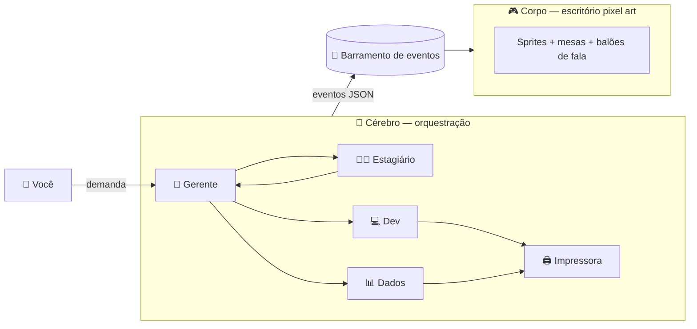

# 🏢 Escritório Multiagente

> **Etapa atual:** `Triagem`
> **Entrada:** 2026-11-06
> **Origem:** vi alguém fazendo — ideia "emprestada", com orgulho.

---

## 1. Inbox — captura bruta

Multiagentes com interface gráfica.
Pixel art. Um escritório.
Cada funcionário na sua mesa = um agente com função fixa.
Eles conversam entre si conforme a demanda chega.

Elenco inicial:

| Personagem | Papel como agente | Faz o quê |
|---|---|---|
| 👔 Gerente | Orquestrador / roteador | Recebe a demanda, quebra em tarefas, delega, junta o resultado |
| 🧑‍🎓 Estagiário | Executor barato | Tarefas simples: resumir, buscar, classificar (modelo pequeno) |
| 💻 Desenvolvedor | Código | Escreve, corrige e explica código |
| 📊 Dados | Analista de dados | SQL, schemas, pipelines, análise |
| 🖨️ Garoto da impressora | Saída / formatação | Transforma resultado em entregável: relatório, PDF, README |

---

## 2. Triagem — respostas honestas

**O problema é real?**
Parcialmente. Multiagente hoje é uma caixa-preta: log de texto infinito.
Ver *quem* está fazendo *o quê* e *quem falou com quem* é um problema real de **observabilidade**.
O escritório pixel art é a embalagem. O valor é enxergar o fluxo.

**Isso já existe?**
Sim. Vários. Pesquisar antes de codar:

- **ChatDev** — "empresa de software virtual" com papéis (CEO, CTO, programador, tester).
- **MetaGPT** — multiagente com papéis de empresa (PM, arquiteto, engenheiro).
- **AI Town** / **Generative Agents (Smallville)** — agentes em mundo pixel art.
- Extensões recentes que mostram agentes de código como bonecos pixel num escritório (provável origem do vídeo).

**Estou apenas empolgado?**
Provavelmente um pouco. O visual é sedutor. Cuidado: 80% do esforço pode ir pro sprite e 20% pro agente.

**Vale investigar?**
Sim — **se** o objetivo for um destes:
1. Aprender orquestração multiagente na prática (valor de estudo, alto).
2. Ferramenta de observabilidade visual para agentes (valor de produto, incerto).

Se for só "ficar bonito", morre aqui.

> ❓ **Pergunta que define a próxima etapa:** isso é laboratório de aprendizado ou produto?

### ✅ Resposta (2026-11-06): nenhum dos dois — é **vitrine**

- **Público:** pessoas não técnicas (time e clientes).
- **Função do pixel art:** ser lúdico e mostrar **até onde dá para ir**, não ser o produto final.
- **Lógica:** se dá para fazer um boneco andar da mesa do Gerente até a do Dev pedindo uma tarefa, dá para fazer o mesmo como dashboard (blocos ligados com luzinhas), ou com visual corporativo.
- **Regra:** o visual é uma **pele trocável**. Gastar o mínimo nele. O contrato de eventos é o ativo.

```text
            ┌──► 🎮 Pele "joguinho" (pixel art)   ← agora
eventos ────┼──► 📊 Pele "dashboard" (blocos + luzes)
            └──► 💼 Pele "corporativa"
```

---

## 3. Esboço — o pensamento essencial

A ideia inteira cabe em uma frase:

> **Cérebro e corpo separados. Um contrato de eventos no meio.**



**Por quê separar?**
- O cérebro funciona sem interface (testável no terminal).
- O corpo funciona sem IA (testável com eventos falsos).
- Trocar LLM, framework ou visual não quebra o outro lado.

### O contrato (a peça mais importante)

Tudo que acontece vira um evento. A interface só **reage**.

```json
{ "t": "task.assigned", "from": "gerente", "to": "dados", "msg": "Gerar query de vendas por mês" }
{ "t": "agent.state",   "agent": "dados", "state": "working" }
{ "t": "message",       "from": "dados", "to": "impressora", "msg": "Tabela pronta" }
{ "t": "task.done",     "agent": "impressora", "output": "relatorio.pdf" }
```

Mapeamento evento → animação:

| Evento | No escritório |
|---|---|
| `seat.assign` | Troca o nome na plaquinha da cadeira (quem está sentado ali) |
| `task.assigned` | Gerente caminha até a mesa do agente |
| `agent.state: working` | Boneco digitando, monitor piscando |
| `agent.state: thinking` | Balão com "..." |
| `message` | Balão de fala / bolinha voando entre mesas |
| `task.done` | Papel saindo da impressora 🖨️ |
| `error` | Fumacinha no monitor 💨 |

### Máquina de estados de cada funcionário

```text
idle ──► walking ──► working ──► talking ──► idle
              ▲                     │
              └─────── error ◄──────┘
```

---

## 4. Micro-etapas (só se passar da Validação)

Cada etapa entrega algo visível. Nenhuma depende de perfeição da anterior.

1. **v0 — Contrato:** escrever o schema dos eventos. Nada mais.
2. **v1 — Corpo burro:** escritório em canvas tocando uma lista de eventos falsos (replay). ✅ [`prototipos/escritorio-multiagente/index.html`](../prototipos/escritorio-multiagente/index.html) — sprites desenhados em código (sem asset de terceiros), já aceita `?ws=` para o cérebro.
3. **v2 — Cérebro burro:** Gerente + 1 agente em Python, imprimindo eventos no terminal. ✅ [`prototipos/escritorio-multiagente/cerebro/`](../prototipos/escritorio-multiagente/cerebro/) — sem LLM: o Gerente roteia por palavra-chave e o agente devolve resposta pronta. **Cadeira ≠ agente:** a cadeira é a casca fixa; quem senta nela vem do `elenco.json` e chega ao corpo pelo evento `seat.assign` (troca só a plaquinha).
4. **v3 — Conectar:** cérebro → WebSocket → corpo.
5. **v4 — Elenco completo:** os 5 papéis, roteamento real pelo Gerente.
6. **v5 — Interação:** clicar no boneco abre o histórico/raciocínio dele.

Stack sugerida (a mais simples, não a mais fácil):
- Cérebro: Python + SDK de LLM direto (sem framework no início — entender o *porquê* antes de abstrair).
- Barramento: WebSocket (FastAPI).
- Corpo: HTML + Canvas (ou Phaser, se crescer).

---

## 5. Pesquisa — em andamento

Referências (o que olhar em cada uma):

| Projeto | Link | Olhar para |
|---|---|---|
| Pixel Agents | [pixel-agents-hq/pixel-agents](https://github.com/pixel-agents-hq/pixel-agents) | **Interface** — escritório pixel art que só *observa* os logs dos agentes (provável vídeo de origem) |
| ChatDev | [OpenBMB/ChatDev](https://github.com/OpenBMB/ChatDev) | **Papéis** (CEO, CTO, programador, tester) + log replayável |
| MetaGPT | [FoundationAgents/MetaGPT](https://github.com/FoundationAgents/MetaGPT) | **Protocolo** entre papéis (PM → arquiteto → engenheiro) |
| AI Town | [a16z-infra/ai-town](https://github.com/a16z-infra/ai-town) | **Mundo** pixel art sincronizado com agentes |
| Generative Agents (Smallville) | [joonspk-research/generative_agents](https://github.com/joonspk-research/generative_agents) · [paper](https://arxiv.org/abs/2304.03442) | **Fundamento** acadêmico: memória, reflexão, planejamento |

- [ ] Ver como o Pixel Agents mapeia atividade do agente → animação (é o nosso "contrato").
- [ ] Ler como ChatDev e MetaGPT definem papéis e protocolo de comunicação.
- [x] Decidir: laboratório ou produto? → **vitrine** (ver Triagem).
- [ ] Listar 3 demandas reais (do trabalho com dados) que esse escritório resolveria.

## 6. Validação — pendente

## 7. Protótipo — pendente
